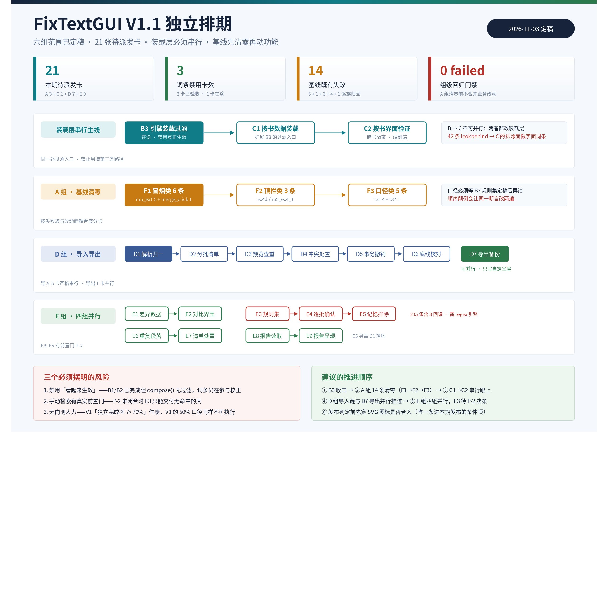
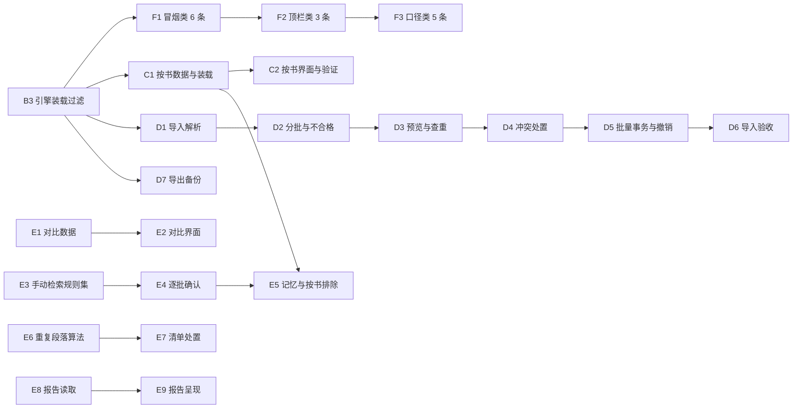

> 本文件由飞书云文档《FixTextGUI V1.1 独立排期文档》导出（docx `F8cSdKnyjonGLGxV966cE8g7nXg`，revision 7，定稿于 2026-11-03），内容与云文档一致；文中 callout 转为引用块、画板导出为同目录图片 `development-plan-v1.1-overview.jpg`。

# FixTextGUI V1.1 独立排期文档

> **📌** **本文档回答一个问题：V1.1 做哪 21 张卡、按什么顺序做、每张卡交什么。**
> V1.1 范围已由用户于 2026-11-03 全部拍板定稿，本文不再讨论范围取舍，只做卡级拆解与依赖排序。V1 排期文档（development-plan.md）已冻结，本文与其范围衔接、不修改其任何内容；凡本文与 V1 文档口径不一致处，以本文为准并在第四、十四章逐条写明差异。

## 一、文档定位与编制依据

### 1.1 定位

本文是 V1.1 的**执行规划**：把已拍板的六组范围拆到「单卡可独立派发」的粒度，给出每卡的交付物、依赖与验收判据，并锁定串行纪律、分支纪律与 V1.2 待评估池。本文只写文档——不含代码、不建任务卡、不改 V1 排期文档。

### 1.2 编制依据（本轮实际读取的材料）

| 材料 | 本文引用的关键结论 | 取得方式 |
|-|-|-|
| V1.1-P1.1 正则规则原版使用方式调研 | 正则是两条独立通道：自动路径约 69 条内嵌静默跑批、手动检索 205 条强制人工确认；执行顺序词条→正则→postFix | 云盘下载全文 |
| V1.1-P1.2 词库批量导入与CSV互转规划 | 建议重定位为单向「批量导入」，导出降为备份；导入 6 卡 + 导出 1 卡 | 云盘下载全文 |
| 评估报告_正则落袋_vs_独立通道 | 判定有条件可行；落袋 9 卡（8–10）与独立通道 10 卡（9–11）基本等价，不省卡 | 云盘下载全文 |
| FixTextGUI_V1.1-T1.2 验收说明 | 基线 460 passed / 14 failed；dev bb7853b；14 条失败全为基线既有 | 云盘下载全文 |
| V1 排期文档 development-plan.md | 7.1 九项承诺、7.4 候选表、6.1 验收口径、4.7 内测任务（范围衔接与差异登记来源） | 云盘下载全文 |

> **💡** **材料定位修正（如实记录）：**本卡给定的 V1 排期文档 file_token 为 `RhSKb9tymoD51MxlFAaclywyn9`，实际该文件夹内该文件的真实 token 为 `RhSKb9tymoD51MxlFAaclywyn9e`（末尾多一位 e）。本文依据的全文取自后者；前者按给定值检索不到文件。此项不影响范围衔接结论，仅记录取值差异。

### 1.3 排期口径（沿用 V1 文档，不新增承诺）

不估工时、不做日历排期。组织单位为**卡**（一轮可完成的独立任务量），每卡必须自带名称、交付物、依赖、验收判据，完成即验收。本文出现的所有卡数，区分三类来源：**已核验口径**（有实测或验收证据支撑）、**报告估算**（P1.2 / P1.3 给出的区间）、**本文规划估算**（E 组细拆，无核验依据、待评审校准）。三者不混用。

## 二、一图看懂

## 三、V1.1 定稿范围（六组）

### 3.1 范围清单

| 组 | 内容 | 卡数 | 卡数来源 | 状态 |
|-|-|-|-|-|
| A | 基线测试失败修复（14 条既有失败全部清零） | 3 | 本文规划（按失败族归因） | 待派发 |
| B | 词条禁用（数据层 / 界面层 / 引擎装载过滤） | 3 | V1 文档 7.4 已核验口径 | 2 卡已完成、1 卡进行中 |
| C | 按书专有词库 | 2 | V1 文档 7.4 估算 | 待派发，依赖 B |
| D | CSV 批量导入 + 导出（仅自定义词库层） | 7 | P1.2 估算（导入 6 + 导出 1） | 待派发 |
| E | 对比视图 / 手动检索 / 重复段落 / 报告 GUI 呈现 | 9 | 本文规划估算 | 待派发 |
| — | 本期明确不做 | — | 见第十三章 | — |

### 3.2 范围不可增删声明

本卡明确：六组范围已全部拍板，本文只做拆卡，**不做任何范围增减**。拆卡过程中若发现某项内部存在前置依赖缺口（如手动检索依赖正则执行引擎），本文的处理方式是**显式登记为卡依赖与前置门**，而不是挪出本期或替换成近似能力——范围不变，前置条件必须摆明。

### 3.3 本期待派发总量

A 3 + C 2 + D 7 + E 9 = **21 张待派发卡**；B 组 3 卡中 2 卡已验收、1 卡在途，不计入待派发。计算依据为上表卡数逐项相加。

## 四、V1 触发门槛的作废说明（重要差异登记）

### 4.1 作废的是什么

V1 排期文档 7.1 规定：V1.1 高级模式的**触发条件为「V1 内测独立完成率 ≥ 70%」**，并据此写了 7.3「后续版本一律由使用数据触发……V1.1 看内测完成率」。

**用户 2026-11-03 决定：该 70% 门槛作废。**理由是本项目独立开发、无内测人力资源，无法组织 5–10 名目标用户的内测并以独立完成率作为开版条件。V1.1 改为**无条件进入**，按本文第五章起的卡序推进。

### 4.2 影响的条款与处理方式

| 被影响的 V1 条款 | 原文口径 | V1.1 生效口径 | 处理 |
|-|-|-|-|
| 7.1 触发条件 | 内测独立完成率 ≥ 70% | 门槛作废，V1.1 无条件启动 | 本文覆盖，V1 文档不动 |
| 7.3 优先级原则 | 无触发信号则不开新版本（V1.1 看内测完成率） | V1.1 已由用户决定直接开版；V1.2 仍按原「使用数据 / 需求信号」逻辑 | 本文覆盖 V1.1 部分 |
| 4.7「内测与易用性验收」任务 | 5–10 名目标用户内测，记录独立完成率 | 属 V1 冻结范围，本文不作变更 | 仅登记，不改 |
| 6.1 验收双口径（易用性 ≥ 50%） | V1 发布硬门槛 | 属 V1 冻结范围，本文不作变更 | 仅登记，不改 |

> **🔍** **必须摆明的连带缺口：**6.1 的「无文档 10 分钟独立完成率 ≥ 50%」与 4.7 的内测任务，同样以「有内测用户」为前提。无内测人力这件事并不只影响 7.1 的 70%，也影响 V1 发布口径的可执行性。
> 本条属 V1 冻结文档的范围，本文**不作任何改判**，只如实登记为待确认项（见附录 B-2）：V1 是否另设易用性替代口径，需由用户决定。

## 五、卡级拆分总表（速览）

| 编号 | 卡名 | 组 | 交付物数 | 依赖 |
|-|-|-|-|-|
| F1 | 冒烟类既有失败修复（6 条） | A | 2 | B3 收口 |
| F2 | 顶栏类既有失败修复（3 条） | A | 2 | F1 |
| F3 | 词库口径类既有失败修复（5 条） | A | 2 | F2、B3 |
| B1 | 词条禁用数据层 | B | — | 已完成 dev 003e3e3 |
| B2 | 词条禁用界面层 | B | — | 已完成 dev bb7853b |
| B3 | 词条禁用引擎装载过滤 | B | 2 | B2，进行中 |
| C1 | 按书词库数据与装载 | C | 3 | B3 |
| C2 | 按书词库界面与端到端验证 | C | 2 | C1 |
| D1 | 导入来源解析与格式归一 | D | 3 | B3 |
| D2 | 超限分批与不合格清单 | D | 2 | D1 |
| D3 | 预览与查重分组 | D | 2 | D2 |
| D4 | 冲突处置与确认执行 | D | 2 | D3 |
| D5 | 批量事务写入与整批撤销 | D | 3 | D4 |
| D6 | 导入验收回归与底线核对 | D | 2 | D5 |
| D7 | 导出一份备份 CSV | D | 2 | B3（可并行于 D1–D6） |
| E1 | 对比视图差异数据层 | E | 2 | 无（可与 C/D 并行） |
| E2 | 对比视图界面与跳转 | E | 2 | E1 |
| E3 | 手动检索规则集迁移与命中统计 | E | 3 | 前置门 P-2 |
| E4 | 手动检索逐批确认交互 | E | 2 | E3 |
| E5 | 手动检索已执行记忆与按书排除 | E | 2 | E4、C1 |
| E6 | 重复段落检测算法与定位 | E | 2 | 无 |
| E7 | 重复段落清单与处置 | E | 2 | E6 |
| E8 | 报告 GUI 数据读取 | E | 2 | 无 |
| E9 | 报告 GUI 界面呈现 | E | 2 | E8 |

合计 21 张待派发卡。B1 / B2 已在 V1.1 主线完成验收，B3 在途，均不计入待派发。

## 六、A 组 · 基线测试失败修复（3 卡）

### 6.0 基线事实

T1.2 验收说明记录：改动前基线 **447 passed / 14 failed**，改动后 **460 passed / 14 failed**（460 = 447 + 13 项 T1.2 新增界面测试），两次失败清单经 `comm -3` 差集为空，**新增失败 = 0**。14 条失败均为基线既有。

14 条的族属分类与条数核对（按本卡给定分类逐项相加）：

| 失败族 | 条数 | 失败类型判断 | 归入卡 |
|-|-|-|-|
| m5_ex1 分袋 smoke | 5 | 断言与已变更的分袋结构脱节 | F1 |
| merge_click | 1 | 交互点击断言失败 | F1 |
| ex4d / m5_ex4_1 顶栏 | 3 | 顶栏控件相关断言 | F2 |
| t31 词库口径 | 4 | 词库计数口径与新增分级/迁入条数不一致 | F3 |
| t37_vocab_bridge | 1 | 装载桥接口契约断言 | F3 |
| 合计 | 14 | — | — |

> **💡** 上表「失败类型判断」一列为**推断**，不是实测结论。判断依据仅是测试名族属与已知改动面（T1.1 新增词条状态层、T1.2 新增迁入分级与计数），实际失败原因必须由 F1 第一张卡内的逐条取证确认后回填。本文不把判断当事实使用。

### 6.1 F1 · 冒烟类既有失败修复（6 条）

**目标**：清零 m5_ex1 分袋 smoke 5 条 + merge_click 1 条，且修法可被同类测试复用。

**交付物**（2 个）：

1. 逐条失败取证与修法说明（每条含测试名、断言原文、实际值、根因、修法），落 md 或卡内评论；
2. dev 分支代码包（zip 保留 .git）+ 该 6 条转为 passed 的测试记录。

**依赖**：B3 收口。理由：B3 要改装载层下发逻辑，分袋 smoke 与 bridge 相关断言处在同一条链路上，先修测试再动装载层会产生二次返工。

**验收判据**：① 6 条全部 passed；② 未新增失败；③ 修法只动测试或最小适配，不以此为由改业务逻辑（若必须改业务逻辑，须单列说明并回退到 B3 排期前确认）。

### 6.2 F2 · 顶栏类既有失败修复（3 条）

**交付物**（2 个）：① 3 条失败的取证与修法说明；② dev 分支代码包 + 测试记录。

**依赖**：F1（同一测试套件内避免并发修改同一文件导致冲突）。

**验收判据**：3 条 passed、未新增失败；若涉及界面可见行为变化，附截图或界面断言证据。

### 6.3 F3 · 词库口径类既有失败修复（5 条）

**交付物**（2 个）：① 4 条 t31 计数口径 + 1 条 t37_vocab_bridge 的取证与口径说明（明确「口径应改测试还是应改实现」的判断及理由）；② dev 分支代码包 + 测试记录。

**依赖**：F2、B3。B3 的过滤会改变实际下发规则集，口径类断言必须在过滤落地后再定稿，否则口径会再变一次。

**验收判据**：5 条 passed；口径变更理由可追溯（不得为过测试而放宽断言）；新增失败 0。

> **🎯** **A 组的设计意图：**3 卡不是按「条数平均分」，而是按**失败族与改动面耦合度**分。冒烟类与装载层耦合最紧、放在 B3 之后先做一对；顶栏类与装载层无关、可紧随；口径类必须等 B3 的规则集变更定稿后再锁断言。若顺序颠倒，口径类会被迫改两遍。

**A 组退出判据（组级）**：全量回归 **0 failed**，即 passed 数 ≥ 460 且 failed = 0。这是 B/C/D/E 各组动业务逻辑的前提——基线不清零就动功能，新增失败将无法与既有失败区分。

## 七、B 组 · 词条禁用（3 卡，2 卡已完成）

### 7.1 已完成卡（不在本期待派发内）

| 编号 | 卡名 | 交付与验收证据 | 状态 |
|-|-|-|-|
| B1 | 词条禁用数据层 | dev `003e3e3`；交付包 `FixTextGUI_V1.1-T1.1_词条禁用数据层_v1.zip`；内容键 `sha256(word + NUL + value)`；用户区 `workspace/vocab/word_states.json`、出厂迁入 `data/word_states/builtin_states.json` | 已完成并验收 |
| B2 | 词条禁用界面层 | dev `bb7853b`（单提交，作者 Doubao Agent Engineer A）；「校正」列行内开关、迁入分级 5,840 条默认禁用、状态总览条、恢复默认 / 清空禁用双总开关、四类操作进撤销栈；新增 13 项界面测试全过 | 已完成并验收 |

> **❗** **必须说清的一个事实（来自 P1.3 实测）：**T1.1 到 `003e3e3` 只落了数据层与指纹，`vocab_bridge.compose()` 里没有 `skipped_disabled` 这一类过滤。**也就是说截至目前，用户禁用一个词条只是让指纹变化，该词条实际仍在参与校正。**「禁用」真正生效要等 B3。B1 / B2 的「已完成」指的是数据层与界面层，不是端到端生效。

### 7.2 B3 · 词条禁用引擎装载过滤（进行中）

**事实基线**：本卡对应 aily 任务 7703831362705132476，当前状态 in_progress。范围限定为「只做词条禁用的引擎过滤，不做正则」。

**交付物**（2 个）：

1. dev 分支代码包（zip 保留 .git）：新增过滤单测 + 全量回归记录 + 端到端证据（禁用一条参与校正的词条 → 校正结果变化；启用 → 恢复，附改前 / 改后输出或哈希对比）；
2. 简要验收说明（md）：改了什么、过滤发生在哪一层、端到端证据、测试结果、已知边界。

**核心技术要求**（依据 P1.3 对代码的定位）：

- 过滤入口落在 `vocab_bridge.compose()` 与 `bags.write_round_rules()` 这一处，出厂侧与自定义侧都过滤；
- 指纹与行为一致：T1.1 已有 `effective_disabled_sha` 进指纹，须确认过滤后指纹与实际下发规则集一致，避免「改了禁用状态、指纹变了、但下发规则没变」或反向脱节；
- 不得为 B3 再造一套过滤，否则 A 组落地时会与既有过滤并存。

**验收判据**：端到端证据成立（不是只有单测）；全量回归新增失败 0；已知边界写明。

**依赖**：B2（已完成）。

### 7.3 B 组退出判据（组级）

「禁用一条参与校正的词条 → 校正输出确实变化；启用 → 恢复为基线输出」的端到端证据成立，且全量回归新增失败 0。二者同时成立才算 B 组收口，才可作为 C 组启动前提。

## 八、C 组 · 按书专有词库（2 卡）

### 8.1 为什么必须串在 B 之后

P1.3 报告的判断：词条禁用与按书专有词库**都改装载层**，须串行；且方向有实际约束——B 的过滤先落地，C 才好在同一处装载层接按书排除。依据是 PHP 原版本就存在「按书排除」机制（`excludedRegexes` / `excludedWords`，`Map.php:161-200`），C 要排除的对象里天然包含正则规则，属于同一需求家族。

> **🔗** **C 与正则的关系：**P1.3 另有一项补充判断——C 的按书排除若覆盖正则类规则，则 C 与「正则落地」也需串行，且 C 应在正则之后或同批。本期正则不做（见第十三章），因此 C 的排除面**限定为字面词条**，正则排除留到 V1.2 正则落地时扩展。这一条是本文的显式取舍，不是遗漏。

### 8.2 C1 · 按书词库数据与装载

**交付物**（3 个）：

1. 按书词库数据形态与存储位置定义（一本书一份，与出厂只读、全局自定义层三级分离）；
2. 装载层按书排除接线（在 B3 落地的同一处过滤入口上扩展，不另造路径）；
3. dev 分支代码包 + 单测（含「全局禁用 + 按书排除」叠加时以哪个为准的判定用例）。

**依赖**：B3。

**验收判据**：同一本书在不同按书配置下校正结果可复现且互不串扰；未配置按书词库的书走全局默认，行为与 B 组收口时完全一致（回归对照）。

### 8.3 C2 · 按书词库界面与端到端验证

**交付物**（2 个）：

1. 界面层：按书词库的查看 / 增删 / 启停入口，复用 B2 的行内开关与撤销栈语义（不另造交互范式）；
2. 端到端验证记录：A 书禁用某词条 → A 结果变化、B 书不受影响；切回 → 恢复。

**依赖**：C1。

**验收判据**：跨书隔离成立；撤销可用；新增失败 0。

## 九、D 组 · CSV 批量导入 + 导出（7 卡）

### 9.1 范围边界（用户拍板）

- 只覆盖**自定义词库层**（`custom_vocab.json` 分级层）；出厂词库只读不动。
- 导出用于**换机 / 备份**场景，不是双向往返。
- P1.2 的结论：「文件级 CSV 往返（外部改过的文件再导回）不进 V1.1」。用户已按「导入 + 导出」定稿，与 P1.2 推荐一致。

> **💡** **一条需要改口径的既有表述：**V1 文档 2.4.3 写「全程 GUI 列表操作，不接触底层词库文件、目录或 CSV」。按字面，连导出也不合规（导出产物就是 CSV）。P1.2 提了两个选项：改表述为「不接触底层文件与目录，导入导出仅经界面」，或维持字面、连导出也进高级模式。
> 本文采用**前者**：底线保护的对象是「用户不得直接编辑底层文件」，而不是「不得有文件产物」。该表述改动属 V1 冻结文档，本文只登记（附录 B-3），不自行改判。

### 9.2 D 组内部依赖（串行阶梯）

导入 6 卡的依赖是**严格串行**的：解析错 → 后面全错；预览没有分组 → 处置无法定义；处置没有确认 → 事务写不了。导出 1 卡与导入链**无依赖**，可并行。

| 卡 | 卡内单卡交付物数 | 依赖 |
|-|-|-|
| D1 来源解析与格式归一 | 3 | B3 |
| D2 超限分批与不合格清单 | 2 | D1 |
| D3 预览与查重分组 | 2 | D2 |
| D4 冲突处置与确认执行 | 2 | D3 |
| D5 批量事务写入与整批撤销 | 3 | D4 |
| D6 导入验收回归与底线核对 | 2 | D5 |
| D7 导出备份 CSV | 2 | B3（与 D1–D6 并行） |

### 9.3 D1 · 导入来源解析与格式归一

**交付物**（3 个）：

1. 粘贴通道：从 Excel / 在线表格复制的文本解析，自动判分隔符与表头，列映射可手改；
2. 文件通道：拖入 csv / txt 的解析，编码自动识别（含 GBK 系），剥 BOM、跳空行；
3. 解析层单测 + 一份样本集（含带引号、带换行、带中文占位符转义的真实样本）。

**依赖**：B3。

**验收判据**：P1.2 指出的原版非标准转义（逗号 / 引号 / 换行被转成中文占位符）能被一次性还原；列映射错配时可纠正；解析失败给出人话原因。

### 9.4 D2 · 超限分批与不合格清单

**交付物**（2 个）：① 超限分批策略（阈值、分批边界、进度反馈）；② 不合格行清单（原因分类 + 可导出）。

**依赖**：D1。**验收判据**：不合格行不阻塞合法行入库；清单可定位到原始行号。

### 9.5 D3 · 预览与查重分组

**交付物**（2 个）：① 导入预览分组（将新增 N / 冲突 M / 格式不合格 K）；② 复用既有查重引擎的接口接线与单测。

**依赖**：D2。**验收判据**：分组数字与实际执行结果一致（不能预览说 N、写入变 N+k）；逐条可取消。

### 9.6 D4 · 冲突处置与确认执行

**交付物**（2 个）：① 冲突项处置交互（改值 / 跳过 / 设为禁用）；② 确认执行的二次确认与影响预览。

**依赖**：D3。**验收判据**：三种处置各自可验证；「设为禁用」与 B 组禁用语义一致（写同一份解除状态，不另造字段）。

### 9.7 D5 · 批量事务写入与整批撤销

**交付物**（3 个）：① 单次批量事务写 `custom_vocab.json`（中途失败不落半批）；② 整批撤销（一次撤销回滚整批，进同一撤销栈）；③ 写入前触发快照并与既有快照机制联动。

**依赖**：D4。**验收判据**：失败可回滚；撤销后文件字节回到导入前；快照可恢复。

### 9.8 D6 · 导入验收回归与底线核对

**交付物**（2 个）：① 端到端验收记录（粘贴通道 + 文件通道各一条完整路径）；② 五条易用性底线的逐条核对表（误删可撤销 / 改错可恢复 / 文件不暴露 / 批量先预览 / 自定义内置分级）。

**依赖**：D5。**验收判据**：五条底线逐条给出通过证据，不得笼统写「符合底线」。

### 9.9 D7 · 导出备份 CSV

**交付物**（2 个）：① 导出功能（自定义词库层全量导出，格式自洽、可被 D1 重新解析）；② 导出说明（用在哪、不能用来干什么——明确不是双向往返）。

**依赖**：B3（可与 D1–D6 并行）。**验收判据**：导出的文件能被本次自己的导入通道无损读回（换机场景闭环）；不触碰出厂词库。

## 十、E 组 · 对比视图 / 手动检索 / 重复段落 / 报告 GUI（9 卡）

### 10.1 E 组前置说明（必须先读）

E 组三项（对比视图、重复段落、报告 GUI）与 V1 主干无强耦合，可并行；**手动检索（E3–E5）不是**——它有真实前置门。

> **🚧** **手动检索的前置门（必须摆明）：**P1.1 确认原版手动检索表共 **205 条规则，其中 3 条是回调函数**；P1.3 确认自动路径 68 条正则中 **42 条用 lookbehind**，Go 引擎（RE2）不支持 lookbehind，Python `re` 只通 48/66、`php_compat` 60/66、仅 PyPI `regex` 66/66。
> 本期正则自动通道不做（用户拍板），但**手动检索同样依赖一个正则执行引擎**。因此 E3 必须在开工前闭合 P-2（是否引入 PyPI `regex` 依赖），否则交付物只能是「规则集 + 统计壳」，无真实命中。

### 10.2 E1 · 对比视图差异数据层

**交付物**（2 个）：① 校正前后差异计算（复用既有快照与替换统计，不重复造 diff）；② 差异数据结构定义与单测。

**依赖**：无（可与 C / D 并行）。**验收判据**：差异结果与替换报告数字一致（同一本书，两处统计不矛盾）。

### 10.3 E2 · 对比视图界面与跳转

**交付物**（2 个）：① 左右对比界面；② 从差异项跳转到书籍位置的定位能力。

**依赖**：E1。**验收判据**：大书（20MB 级）打开不卡死；定位准确；不修改原文（只读视图）。

### 10.4 E3 · 手动检索规则集迁移与命中统计

**交付物**（3 个）：① 205 条规则迁移（含 3 条回调的等价实现，回调不能静默降级为字面）；② 命中统计与排序（按文件顺序 / 替换次数 / 优先级颜色分组）；③ 规则集单测。

**依赖**：**前置门 P-2 闭合**（正则引擎与依赖决策），本卡不依赖 B/C。**验收判据**：205 条逐条可编译（或显式登记不可编译条目与原因）；回调 3 条有等价行为验证；同一本书命中数与人工抽查一致。

### 10.5 E4 · 手动检索逐批确认交互

**交付物**（2 个）：① 索引 / 范围批量选择与「执行 / 跳过」交互；② 每批替换前的备份与确认。

**依赖**：E3。**验收判据**：未经确认不得落盘；跳过可回退；每批可单独撤销。

### 10.6 E5 · 已执行记忆与按书排除

**交付物**（2 个）：① 已执行规则的 mark 记忆（写入按书词库，下次自动排除不重跑）；② 与 C 组按书词库的联动接线。

**依赖**：E4、C1。**验收判据**：重跑同一本书不重复提示已执行规则；换书不串扰。

### 10.7 E6 · 重复段落检测算法与定位

**交付物**（2 个）：① 重复段落检测算法（跨段 / 跨章的相似与完全重复，阈值可调）；② 命中位置的可定位数据结构。

**依赖**：无。**验收判据**：已知样本集内召回与误报有量化记录（本期只要求可量化，不承诺具体阈值）。

### 10.8 E7 · 重复段落清单与处置

**交付物**（2 个）：① 重复清单界面（分组、定位、跳转）；② 处置动作（标记 / 忽略，不提供自动删除——破坏性动作需二次确认且默认不做）。

**依赖**：E6。**验收判据**：清单可定位；处置不修改原文；撤销可用。

### 10.9 E8 · 报告 GUI 数据读取

**交付物**（2 个）：① 替换报告文件的解析（V1 已约定以 CSV / 文本形式留存）；② 数据结构与容错（缺列、空行的处理）。

**依赖**：无。**验收判据**：V1 导出的真实报告文件可被解析；字段缺失不崩溃并给出人话提示。

### 10.10 E9 · 报告 GUI 界面呈现

**交付物**（2 个）：① 报告可视化呈现（命中数、涉及词库、按词库 / 按规则的汇总）；② 与对比视图 / 书籍位置的联动跳转入口。

**依赖**：E8。**验收判据**：界面数字与报告文件数字逐项一致（同一份文件，两处不得出现不同总数）。

## 十一、依赖关系与串行纪律

### 11.1 串行链（必须遵守）

### 11.2 三条硬约束

1. **装载层唯一入口**：B3、C1 都只在 `vocab_bridge.compose()` / `bags.write_round_rules()` 这一处过滤入口上扩展。任何一张卡另造第二条过滤路径即为违规，评审退回。
2. **基线先清零**：A 组 0 failed 之前，C / D / E 不得合并动业务逻辑的提交（可并行开发，但合并顺序受此约束）。
3. **B → C 串行不可并行**：两者都改装载层，同处代码同时动两件事的冲突与回归成本不划算（V1 文档 7.4 与 P1.3 4.2 双重确认）。

### 11.3 可并行的窗口

| 可并行组 | 条件 |
|-|-|
| D7 导出 ∥ D1–D6 导入链 | 两者无代码依赖，但同改词库读写层时需协调提交顺序 |
| E1–E2、E6–E7、E8–E9 ∥ B/C/D | 三组均不触碰装载层，无冲突 |
| E3–E5 ∥ B/C/D | E3 只读规则集，但 E5 依赖 C1，须等 C1 落地 |

## 十二、卡粒度的硬标准与自检

### 12.1 硬标准

单卡必须同时满足：① 可独立验收的交付物 **≤ 3 个**；② 单轮可完成；③ 交付物之间是同一件事的三个面，不是三件事。超出即拆卡。

### 12.2 自检结果

| 检查项 | 结果 |
|-|-|
| 是否有卡超过 3 个交付物 | 无。D1 / D5 / E3 为 3 个，其余为 2 个 |
| 是否有卡交付物之间不属于同一目标 | 无。每卡 2–3 个交付物均为「实现 + 证据 / 说明」的同一目标组合 |
| 是否有卡依赖未在本文定义的前置 | 无。E3 的 P-2 前置门已在 10.1 与 V1.2 池双处登记 |
| 是否有卡把两个可独立验收的能力塞在一张 | 无。C1 数据 / C2 界面已拆；E1 数据 / E2 界面已拆；D1 解析 / D2 分批已拆 |

### 12.3 与 V1 文档卡数口径的差异（必须登记）

V1 文档 7.4 记录：词条禁用 3 卡（**已核验口径**）、按书专有词库 2 卡（**估算**）、正则接入 10 卡（区间 9–11）、暗色模式 / 图标 3 卡（估算）。本文口径：

| 项 | V1 文档 | 本文 | 差异原因 |
|-|-|-|-|
| 词条禁用 | 3 卡 | 3 卡（B1/B2 完成 + B3 在途） | 一致，沿用核验口径 |
| 按书专有词库 | 2 卡 | 2 卡 | 一致 |
| CSV 导入导出 | 未定（7.4 未列） | 导入 6 + 导出 1 = 7 卡 | 取自 P1.2 估算 |
| 对比视图 / 手动检索 / 重复段落 / 报告 GUI | 7.1 列为四项承诺，未给卡数 | 9 卡 | 本文规划估算 |
| 基线失败修复 | 无此项 | 3 卡 | 本期新增的必要前置（14 条既有失败阻断回归判定） |
| 正则自动通道 | 10 卡（9–11） | 本期不做 | 用户 2026-11-03 拍板 |

> **📐** 「对比视图 / 手动检索 / 重复段落 / 报告 GUI」的 9 卡是**本文规划估算**，无核验依据。E3 因含 205 条规则迁移与 3 条回调等价实现，实际可能需再拆。评审时以本文的卡边界为准，卡数可校准。

## 十三、本期明确不做与去向

### 13.1 不做清单

| 项 | 用户决定（2026-11-03） | 去向 | 依据 |
|-|-|-|-|
| 正则自动通道（68 条） | 本期不做 | 架构方案存档进 V1.2 评估（见 14.1） | 拍板；方案与三条前置 P-1/P-2/P-3 已具备 |
| 暗色模式 | 不做 | 待排期池 | 拍板 |
| 引入数据库 | 不做 | 待排期池 | 拍板；V1 文档 7.4 亦记「不排期」 |
| SVG 图标独立分支 | 视最终效果决定是否合入本期发布 | 发布判定时决策 | 拍板（条件性，非排除） |

### 13.2 关于 SVG 图标的处理说明

该项是唯一「条件性」条目：分支已在（云盘有 `FixTextGUI_M6-T6.5_svg-icons分支_v1.zip` 与 `FixTextGUI_M5-MG.1_svg-icons_src.zip`）。本文的处理是把决策点挂到发布判定（见第十六章），**不预设结论**，也不把它算进 21 张卡。若合入，作为独立的一张发布前卡评估，届时增补。

### 13.3 关于「不做」不是「没能力」

> **💡** 正则自动通道本期不做，是因为**它会把 V1.1 的交付面从「词库与界面能力补齐」扩成「引擎执行层重构」**——P1.3 实测已证明落袋不省卡（9 卡 vs 独立通道 10 卡），且必须新增 PyPI `regex` 依赖与跨语言编排。这是范围取舍，不是技术不可行。方案与前置条件完整存档，V1.2 可直接启动评估。
> 同时须注意：手动检索（E3）**仍然依赖正则执行引擎**。本期不做的是「自动通道」，不是「正则引擎能力」。这个区分若不摆明，E3 会被误以为零依赖。

## 十四、V1.2 待评估池

### 14.1 正则落袋方案（P1.3 结论 + 三条前置 + 两案详情）

#### 14.1.1 P1.3 的核心结论

**判定：有条件可行。**关键结论三条：

1. **「落袋」只解决组织与开关，解决不了执行。**实测把 66 条正则串以字面 `before` 注入现有袋、跑真实 Go 引擎，输出与基线**逐字节相同**（880,739 vs 880,739）。规则进了袋、引擎没反应、也不报错——这是静默失效，比不做更危险，因为它看起来做了。
2. **Go 腿无法承担正则。**66 条中 42 条用 lookbehind，Go `regexp`（RE2）不支持 lookbehind。正则腿只能落 Python 侧。
3. **旧「Go +95%」不可直接套用。**换基线重测：3.14M 字符上正则腿 2.713s，是单趟扫描（0.25s）的 **1085.2%**、两趟（0.51s）的 **532.0%**、整本含装载（1.093s）的 **248.2%**。方向一致、幅度更大，应表述为「正则腿让整本处理总耗时增加 1.5–3 倍」。

**卡级**：落袋 9 卡（8–10）；独立通道 10 卡（9–11）。**两者基本等价，落袋不省卡。**

**一处额外收益（原估算没有）**：按档位装载时单档只跑 10–39 条，成本 0.06–1.85s，全集 66 条是 2.71s。落袋按档装载在性能上占优。

#### 14.1.2 三条前置（开工前必须闭合）

| 前置 | 问题 | 不闭合的后果 |
|-|-|-|
| **P-1（顺序）** | V1 的 `BookMap` 阶段是否等价于 PHP 的 `postFix`？ | 若不等价，正则阶段插入位置会错（应插在 `ReplaceZhuyin` 之后、`BookMap` 之前还是之后再补 postFix 阶段未定） |
| **P-2（依赖）** | 是否引入 PyPI `regex` 作为正则引擎？ | `re` 只通 48/66、`php_compat` 60/66，仅 `regex` 66/66。不引入则 18 条规则无法执行 |
| **P-3（语义）** | 档位是「互斥」还是「叠加」？ | PHP 每次只持一套正则（档 1 只跑 17 条）；V1 的 `concat_bags()` 是累加，档 1 会跑 39+17=56 条。默认叠加即行为不等价 |

#### 14.1.3 两案详情（互斥 vs 叠加）

**案一 · 互斥（对齐 PHP）**

- 做法：改 `main_bag_ids()` 的选择逻辑，选 A 档则排除 B 档的正则组，使每档只跑自己那套。
- 优点：与原版行为等价，误改概率维持原设计；「按原版归属落袋」的初衷得以成立。
- 代价：装载选择逻辑改动面扩大；档位组合的语义要在界面上讲清（用户勾多个档时正则跟随哪个）。
- 适用：目标是「与原版等价 + 配置语义一致」。

**案二 · 叠加（接受扩大作用面）**

- 做法：保持 `concat_bags()` 累加，档 1 同时跑 39+17 条。
- 优点：不动装载选择逻辑，改动最小。
- 代价：**必须重做一轮误改评估**——多跑的 39 条在 extraMap 档下从未被原作者评估过误伤；且错改由 postFix 兜底，兜不住的会直接落到用户文本。
- 适用：能接受行为与原版不同，且愿意承担一轮误改评估成本。

#### 14.1.4 与 P1.1 的口径差异（一并存档）

- 条数：P1.1 记 69（把 `strictRegexMap` 区间内 3 条被注释的也计入）；P1.3 实测**在用 68**（主文件 66 = 39+17+10，旧式通假 1 + 临时表 1）。建议统一按 **68** 引用，并注明 69 的来历。
- 档位数：P1.1 记「3 档开正则」；P1.3 核对 `src/config/map.php` 实为**4 档**（档 0 / 1 / 2 旧式通假 / 8 临时表均为 true）。
- 这两处差异属 V1.2 评估输入的口径修正，不影响本期范围。

### 14.2 暗色模式（待排期池）

**已知**：V1 文档 7.4 记「暗色模式 / 图标 3 卡（估算）」，并注明「此前明确不做，需重新确认」。

**本文处理**：用户 2026-11-03 拍板本期不做，进待排期池。**不预设卡数**——3 卡是估算，且该项与「图标」捆绑记录，是否捆绑拆分需在启动时重新确认。触发条件待用户另行决定。

### 14.3 数据库（待排期池）

**已知**：V1 文档 7.4 记「引入数据库｜不排期｜仅备忘，不进任何排期」。

**本文处理**：沿用「不排期」。当前存储形态（JSON 词库 + 快照 + 历史目录）在 V1.1 范围内没有触到必须用库的规模：词库 304,255 条规则、单机单用户。若未来出现「多书批量 + 跨设备同步」（V1.2 协作与云方向），才具备评估起点。**不给卡数、不给触发条件的具体阈值**——没有真实规模数据支撑，写具体阈值就是编。

### 14.4 待评估池的共同纪律

> **🔒** 待评估池里的任何一项**不得夹带进 V1.1 的任一卡**。若某卡实现过程中发现「顺手就能做」，一律按 V1 文档 7.4 / 5.2 的风险应对处理：退回，先进待评估池并注明触发条件。这条是防范围蔓延的唯一硬闸。

## 十五、分支纪律与提交规范

### 15.1 分支纪律

| 规则 | 内容 | 证据 / 现状 |
|-|-|-|
| 开发分支 | V1.1 开发一律在 **dev** 分支 | T1.1 `003e3e3`、T1.2 `bb7853b` 均在 dev |
| 分支起点 | dev 从 master **245b7cd** 拉出 | 已确立的基线 |
| 禁止 | **禁止直接在 main / master 提交** | T1.2 验收说明明确记「master/main 零提交」 |
| 基线传递 | 每卡基线为上一卡上传云盘的代码包，`lark-cli drive +download` 取包解压后继续在 dev 提交 | T1.3 卡内已按此执行 |
| 合入 | 动业务逻辑的卡合入 dev 前，须满足 A 组 0 failed（见 11.2） | 本文约束 |

### 15.2 git 提交作者规范

V1.1 全部提交的作者一律为：

- **姓名**：`Doubao Agent` 前缀 + 身份（如 `Doubao Agent Engineer A`）
- **邮箱**：`&lt;doubao-engineer-a@local&gt;`

实测证据：T1.2 提交记录为「单提交，作者 Doubao Agent Engineer A &lt;doubao-engineer-a@local&gt;」。多位工程师并行时按身份后缀区分（A / B / …），**不得混用同一身份提交不同卡**，否则责任链断裂、复核无法定位到卡。

### 15.3 打包硬要求（沿用，逐卡执行）

- 排除 `workspace/`、`runs/`、`screenshots/`、`__pycache__`（命中数须为 0）；
- zip 保留 `.git`（T1.2 包为 132 条 .git 条目、509 个文件）；
- 干净解压后 `opens_on_first_run()` 必须为 `True`；
- 交付物上传云盘 `projects/fix_text/code`（folder_token `IIvifoTtFlIhXKdQBtrcDQYdnlW`）。

### 15.4 下载纪律（沿用）

凡需从外网下载新内容，先暂停并在卡内评论告知用户「需要什么 + 官方地址」，由用户下载上传云盘后继续；云盘已有材料用 `lark-cli drive +download` 直接取。**本期唯一已知可能触发该纪律的点是 P-2 的 PyPI `regex` 依赖**（见 10.1）——若决策为引入，须先按此纪律报备。

## 十六、V1.1 验收与发布判定

### 16.1 验收口径

V1.1 **不沿用 V1 的易用性内测口径**（其前提已不成立，见第四章）。改为三条可执行判据：

| 判据 | 内容 | 取证方式 |
|-|-|-|
| 正确性 | 全量回归 **0 failed**，passed 数 ≥ 基线 + 各卡新增 | 每卡提交回归记录；组级汇总 |
| 生效性 | 每卡「功能确实生效」的端到端证据（不是只有单测） | 改前 / 改后输出或哈希对比 |
| 底线 | V1 词库五条易用性底线（2.4.3）在新增的导入导出路径上逐条成立 | D6 的底线核对表 + 手工复核 |

**不设「独立完成率」类指标**——本文如实说明：本项目无内测人力资源，任何以「用户实测完成率」为判据的验收项，在本项目当前条件下不可执行。改以「端到端生效证据 + 底线核对表」替代，这是可验证的替代口径，不是降低标准。

### 16.2 发布判定清单

1. A 组 14 条既有失败全部清零，0 failed；
2. B 组端到端生效（禁用 → 结果变化、启用 → 恢复）；
3. C 组跨书隔离成立；
4. D 组五条底线逐条有证据；
5. E 组各卡功能生效、界面数字与数据源一致；
6. 每卡交付物齐（代码包 + 验收说明），云盘归档完整；
7. 分支纪律核验：dev 分支、作者规范、master/main 零提交；
8. **SVG 图标合入决策已作出**（合入则作为增补卡评估；不合入则记录理由）。

任一条不满足即不发布，按对应卡返工；全部满足即 V1.1 发布。发布不附带超出本清单的质量宣称。

## 十七、风险登记（预警信号 → 应对）

| 风险 | 预警信号 | 应对 |
|-|-|-|
| 装载层被绕开 | 出现第二处禁用 / 按书过滤路径 | 评审门禁直接退回（11.2 第 1 条） |
| 口径反复 | 同一断言在 F3 与后续卡里两次改动 | 先把 B3 收口再定 F3 口径（6.3 依赖设计） |
| 导入的预览与写入不一致 | 预览说 N 条、写入变 N+k | D3 验收判据明确要求数字一致，不一致即返工 |
| 手动检索零命中交付 | E3 交付「规则集 + 统计壳」无真实命中 | 前置门 P-2 未闭合不得开工 E3 |
| 卡数低估 | E3 或 D1 实际超 3 个交付物 | 按 12.1 拆卡，卡数校准不视为范围变更 |
| 范围蔓延 | 任一卡夹带 14.1–14.3 待评估池内容 | 退回，先进池并注明触发条件 |

## 附录

### A. 假设与口径（显式标注）

- **卡数来源分类**：词条禁用 3 卡为已核验口径；按书专有词库 2 卡、CSV 导入 6 卡、导出 1 卡为报告估算；A 组 3 卡与 E 组 9 卡为本文规划估算。**后者无核验依据，待评审校准。**
- **不估工时、不做日历排期**：本文所有排序指依赖顺序，不构成时间承诺。
- **失败类型判断**：第六章表格中的「失败类型判断」为推断，须由 F1 取证后回填（已在 6.0 注明）。
- **性能数字**：均引自 P1.3 实测（1 核 / 4GB，3.14M 字符，全部 304,255 条规则口径），不引用已被取代的旧 +95%。P1.3 自述其早期中间稿曾因漏 `x`（VERBOSE）标志误报编译失败，补上后 66/66 通过、耗时从 0.878s 上调到 2.713s——本文引用的是修正后数值。
- **规则条数**：统一按 68（在用）引用；69 为 P1.1 含 3 条注释规则的口径。

### B. 待用户确认项（不影响本文完成度，但影响后续执行）

| 编号 | 事项 | 为什么需要确认 | 不确认时的默认处理 |
|-|-|-|-|
| B-1 | E3 是否引入 PyPI `regex` 依赖 | E3 的命中能力取决于此；引入需按下载纪律报备 | 按「未闭合不开工」处理，E3 挂起 |
| B-2 | V1 发布口径（6.1 易用性 ≥ 50% 与 4.7 内测）是否另设替代 | 无内测人力，原口径不可执行；但属 V1 冻结文档 | 本文不改判，如实登记为缺口 |
| B-3 | V1 文档 2.4.3「不接触 CSV」表述是否按 9.1 修订 | 与导出的字面冲突 | 本文按「不接触底层文件与目录、导入导出仅经界面」理解，不改 V1 原文 |
| B-4 | SVG 图标是否合入本期发布 | 拍板为「视最终效果决定」 | 发布判定时决策，不计入本期卡 |

### C. 与 V1 文档的关系

本文**只作范围衔接**，未修改 V1 排期文档任何内容。差异点集中在两处：① 第四章的 7.1 / 7.3 触发门槛作废（用户决定覆盖）；② 第十二章 12.3 的卡数口径差异。其余（2.2 首屏 6 入口、2.3 P0 五项底线、2.4.3 五条底线、3.x 架构、4.x 里程碑、5.x 依赖风险、6.x 验收）全部沿用，不重新定义。

### D. 来源清单

| 材料 | file_token | 用途 |
|-|-|-|
| V1.1-P1.1 正则规则原版使用方式调研 | `IxuIbnLHGoNHjdxaLeQcCOiInhf` | 正则两条通道、205 条手动检索与 3 条回调 |
| V1.1-P1.2 词库批量导入与CSV互转规划 | `UQX5b8QRdoaHYFxNMdRcjjOyncc` | 导入 6 + 导出 1 卡、五条底线兼容判断 |
| 评估报告_正则落袋_vs_独立通道 | `XFkebRfLEoCHTjxPgt7cZRIhnMc` | 9 卡 / 10 卡对比、三条前置、互斥 vs 叠加 |
| FixTextGUI_V1.1-T1.2 验收说明 | `Wqu2bASVuotobPx2w1PcS5NNn8f` | 460/14 基线、dev bb7853b、13 项新增测试 |
| V1 排期文档 development-plan.md | `RhSKb9tymoD51MxlFAaclywyn9e` | 7.1 / 7.3 / 7.4 / 6.1 / 4.7 口径衔接 |
| T1.3 任务卡（进行中） | aily task 7703831362705132476 | B3 范围与交付物定义 |